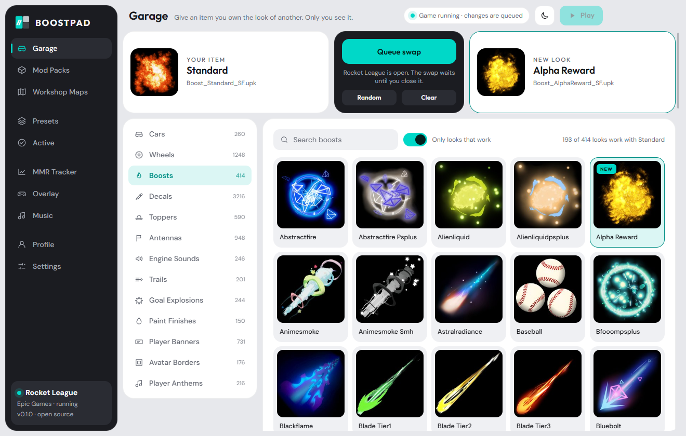

# Boostpad

A free, open-source cosmetic mod manager for Rocket League on Windows (Epic Games and Steam).

No account, no subscription, no server. Everything runs on your PC, and every game file Boostpad changes is backed up first and can be put back with one click.

> **Status: early (v0.1).** The app, the backup engine, workshop maps, mod packs, presets, tracker, overlay and profile cards work. **Item swaps are experimental and have not been confirmed in game yet** — see [What works](#what-works) before you rely on them.

| Dark | Light |
| --- | --- |
|  |  |


## Read this first

- Rocket League runs with Easy Anti-Cheat. Boostpad does **not** touch, disable or work around it, and it never injects into or reads the running game. It only replaces files on disk while the game is closed.
- Changing game files may break Rocket League's terms of service and could put your account at risk. Nobody can promise modified files are accepted online. **Use it at your own risk.**
- Your launcher's "Verify files" always restores a clean install.
- Boostpad is a fan project, not affiliated with or endorsed by Psyonix or Epic Games.

## Features

| Tab | What it does |
| --- | --- |
| **Garage** | Give an item you own the look of another item (cars, wheels, boosts, decals, toppers, antennas, engine sounds, trails, goal explosions, paint finishes, banners, borders, anthems). Items are shown with their real names and pictures, read from your own game files, and each section lists only its own items. A search stays in the section you are in and tells you which other sections also have a match. Once you pick your item, only the looks that work with it are listed. Everything applied or queued is listed there with a Revert button. |
| **Workshop Maps** | Load a training/challenge map into the Underpass slot and play it from Free Play. |
| **Map Merge** | Mix the game's own arenas: put the stadium of any soccar arena into the surroundings of any other, make an arena snowy where the game has a snowy version, or see the same arena, merged ones too, in every match. Arenas are listed under the names the game uses, and each change says which arena to play to see it. Experimental. |
| **Training** | Freeplay checkpoints: rewind Free Play, save a moment, jump back and try the shot again. Boostpad sets the buttons and options of the Freeplay Checkpoint plugin for BakkesMod (live over BakkesMod's RCON while it runs, in its config files while it is closed). Needs BakkesMod and the plugin. |
| **Controller** | Steam Input for the Epic version, for Steam's own stick settings (square dead zone, outer ring, anti-deadzone, response curve). Boostpad adds a Steam shortcut, "Rocket League (Steam Input)", that starts the Epic Games Launcher with Rocket League, which is how Steam Input reaches Epic games; the Play button can start the game that way. Steam is closed while its shortcut file is changed (it rewrites the file on exit), and a copy of the file is kept. The Epic launcher must be closed when the game starts, or Steam never sees the game. Not checked with a controller yet. |
| **Presets** | Save everything that is active and switch setups in one click. Unlimited. Copy a preset as a code to pass it on. |
| **Swap queue** | Changes made while the game is running wait and go in when it closes. |
| **Overlay** | Click-through windows over the game, shown only while Rocket League is the window in front. A now-playing pill for your music, and a top-down PS5, PS4 or Xbox controller (picked automatically from the one plugged in) that lights up with your inputs. Each has its own position (drag it, or pick a corner), size and look. |
| **Profile** | A profile card with any name, title, colour, glow, rank badge and picture. It lives in the app. |
| **Themes** | Dark or light. Both use the icon's turquoise; the light theme adds charcoal blocks. |

### Music in the overlay

The now-playing pill reads Windows' own media controls, so there is no login and no API key, and it works with anything that shows up in the Windows volume flyout: Spotify, Apple Music, TIDAL, Deezer, Amazon Music, Qobuz, YouTube Music and SoundCloud in a browser, VLC, foobar2000, MusicBee, AIMP and Windows Media Player. You can follow one app or whichever is playing. It follows music playing on this PC, not on your phone.

### Map Merge

Any two standard soccar arenas can be merged (61 on the test machine), strictly: only the stadium of the arena you pick as the stadium shows (pitch, walls, goals, stands, crowd), and around it only the outside, sky and fog of the arena you place it in. Nothing of the stadium arena's outside and nothing of the other arena's stadium comes along.

Every merge is built at the object level (`src/main/core/mapbuild.js`). Arenas are a main `_P` map plus part files it loads by name (`_Field`, `_OOB`, effects, sound); older ones keep stadium and outside together in the main map. Boostpad reads both arenas and sorts every placed piece:

- **Where each stadium is.** An arena's stadium is the pitch area (walls and goals) plus the footprint of each of its stands, measured from the map: every mesh named like stands or crowd, placed with its component's translation, rotation and scale, mirrored both ways. Parc de Paris has stands only behind the goals, so its open park sides are outside, not stadium.
- **Stadium side.** Pieces mostly inside that region stay, plus flat ground centred under it and pieces named after the stadium that stick out a little (outer arches). Anything named OOB, the sky, clouds and fog are hidden. Gameplay (boost pads, goals, spawns, collision) and the stadium's lights stay.
- **Outside side.** Pieces inside either stadium are hidden, so nothing of the place arena's stadium shows and nothing stands inside the new one. Sky, clouds and fog stay; gameplay and lights are taken out of the level. Big flat ground below the pitch stays, so the stadium does not float over a hole.

The place arena stays its own map: its main file keeps everything (sky, lights, fog, surroundings, gameplay, collision) except its stadium pieces and anything standing where the new stadium goes. Its stadium file (and, when more room is needed, a sound part, whose background sounds then go quiet) is renamed in its name table to new files Boostpad adds, holding only the stadium arena's stadium pieces: from its stadium file, its main map and any part that holds some of its stadium (Champions Field's upper ring is in CS_OOB2), without their gameplay, lights, sky or fog. The place arena's outside parts load as filtered copies; its effects and lights parts load as they are. A place arena with no stadium file and no sound part (Mannfield and Mannfield (Dusk) are single files) gets the other way round: the stadium arena's map is the base and the place arena's map, sky included, loads in its parts; its light and fog are then the stadium arena's, and the page says so. Every edit keeps sizes the same (a mesh reference set to none, an actor reference cleared, a name shortened in place), so only the compressed chunks and the chunk table change; added files use the game's common key and are deleted again on revert.

Sorting is by name and position, so an odd piece can still land on the wrong side. Checked in game on the test machine with the earlier, looser sorting (0.1.2-0.1.5): stadium-file swaps (Neon Fields in AquaDome, Fire & Ice in Salty Shores (Night)) and whole-arena swaps load and play. 0.1.6 used the stadium arena's map as the base, which left the sky black when the place arena's main map did not fit (Beckwith Park (Snowy) in Forbidden Temple (Day)); 0.1.7 keeps the place arena's map. Checked against the real maps (what each side keeps), **not in game yet**. Hoops, Dropshot, Snow Day and odd-shaped arenas are left out, because the pitch shape comes with the stadium.

Changes are written while Rocket League is closed. The game keeps the arena files it read at start, so a file changed while it runs only shows after a restart.

**Snow.** Falling snow exists only inside the game's four snowy arenas (DFH Stadium, Mannfield, Beckwith Park and Utopia Coliseum, snowy versions); a search of every package found no separate snow file. So an arena built on one of those four becomes its snowy version, swapped in whole. Merged arenas cannot get snow, because the snowy version would replace the files the merge changed; merging a stadium into Forbidden Temple (Fire & Ice) or into one of the snowy arenas gives snowy surroundings instead. (0.1.2 and earlier offered "snow" from Forbidden Temple (Fire & Ice)'s effects file; checked in game, that file is its fire dragon, so the option is gone.)

**Same arena every match** makes every standard soccar arena file a copy of the one you pick, so whatever arena a match is played in, you see that one. Your merged arenas can be picked too: a stadium or surroundings merge comes along because the copied main file loads the merged files by name (checked in game: Mannfield set to load AquaDome's main file showed all of AquaDome), and for a whole-arena merge the arena merged in is used. Arenas you merged or snowed yourself keep your change. Rocket Labs, Hoops, Dropshot, Snow Day, Knockout and odd-shaped arenas are left alone. The originals are backed up first, which takes about 1.3 GB until you turn it off.

## What works

| Area | State |
| --- | --- |
| Finding the game (Epic, Steam), running check, Play button | Tested on an Epic install |
| Backup, restore, queue, game-update detection | Covered by automated tests on copies of real game files |
| Item catalog and pictures | Built from your own install (about 8,600 items on the test machine). Pictures are decoded from the game's thumbnail packages and cached: about two thirds with the built-in key, about 97% with a key list added |
| Item swaps | **Experimental.** The package rewrite is tested structurally (see below) but nobody has yet confirmed the result in game |
| Workshop maps | File replacement is tested; whether a given map loads depends on the file |
| Overlays, profile | Working. The now-playing reader is tested against a real Windows media session (title, artist, cover, pause) and the controller drawing against a real pad; the overlays have not been checked over the running game |
| Map Merge | **Experimental.** The arena scan and the file replacement are tested; stadium and whole-arena merges have been checked in game on one or two arenas, not on every pair; built merges are covered by a round-trip test on a real map but not checked in game yet. Same arena every match is checked on one arena; the snowy versions are the game's own arenas |

Fixed in 0.1.1: when the item you own and the new look were encrypted with different keys, 0.1.0 wrote the swapped file with the wrong one and the game crashed when it loaded the item. Swaps and arena changes are now written with the key of the file they replace, and anything 0.1.0 wrote wrongly is rebuilt automatically the next time Boostpad runs with the game closed.

Known limits of item swaps in this version:

- **The game must be closed.** If Rocket League is open the swap is queued and applied when you close it; you see it the next time you start the game.
- A swap renames the new look's package to your item's name **in place**, so your item's internal name must not be longer than the new look's (for example Standard boost -> Alpha Reward works, Octane -> Venom does not). On the test machine about half the looks in a category work for a given item. The Garage lists only those once you have picked your item.
- Boostpad ships one decryption key, the long-published community one, which opens roughly two thirds of items. The rest show a lock instead of a picture and cannot be used as a new look. If you have a key list (a `keys.txt`, one key per line in hex or base64, as published by community tools), add it under **Settings -> Item pictures and keys**; on the test machine that raised coverage to about 97%. Key lists are not included in this repository.
- Other community tools that swap items the same way report that **car body and goal explosion swaps can crash the game**. Treat those two categories as the riskiest.
- Item names come from the game's own English text file, which needs a key from a key list. With only the built-in key, items are listed under their internal file names (some cars have code names).

Not implemented: custom paint colours, 3D garage preview, custom balls and sounds, stadium colours, and changing your name, title or rank **inside** the game. The last one would need code injected into the running game, which Boostpad does not do.

## Run it

Requires [Node.js](https://nodejs.org) 20 or newer.

```
git clone https://github.com/Manow17/boostpad.git
cd boostpad
npm install
npm start
```

To find Boostpad from the Windows Start Menu (search for "Boostpad"), add a shortcut once:

```
npm run shortcut
```

It starts this copy of the app, so keep the folder where it is. `npm run shortcut -- --remove` takes it away again.

Run the tests (they copy a few packages to a temp folder and never write to your game):

```
npm test
```

## How a swap works

Each item is a package file such as `WHEEL_Star_SF.upk` whose contents answer to the name `WHEEL_Star`. To make item A look like item B, Boostpad takes B's package, renames `B` to `A` in its name table, and writes the result over A's file. The rename keeps the exact byte size (shorter names are padded), so nothing else in the file moves and the compressed data is never rewritten. A's original file is copied to Boostpad's data folder first.

## Project layout

```
src/main/core/   game.js (find game)  upk.js (package reader/patcher)  engine.js (apply, back up, revert, queue)
                 catalog.js (items)   labels.js (item names)   thumbs.js (item pictures)   arenas.js (map merge, snow)
                 library.js (workshop maps)  store.js (settings)
src/main/        main.js (window, IPC)  preload.js  media.js + media.ps1 (now playing, via Windows)
src/renderer/    app.js, styles.css, pad.js (controller drawing), overlay + nowplaying (overlay windows)
assets/          app icon (icon-source.webp, turned into icon.png with `npm run icon`), fonts, and
                 controllers/ (MIT drawings, credits in CREDITS.md; rebuilt with `node scripts/prepare-controllers.js`)
test/            core tests
```

## Contributing

Reports of what does and does not load in game are the most useful thing right now. Please include the two items and what you saw.

## License

MIT. The bundled fonts, Outfit and DM Sans, are under the SIL Open Font License (see `assets/fonts`). The controller drawings are MIT-licensed work by the Dracula Theme team and Igor Budzhak (see `assets/controllers/CREDITS.md`). Rocket League is a trademark of Psyonix LLC. This repository contains no game files; the screenshots show item pictures as the app displays them from your own install.
