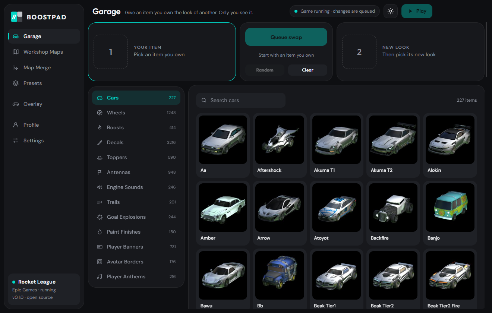
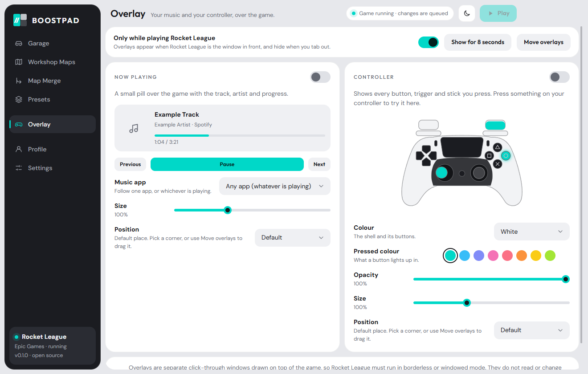

# Boostpad

A free, open-source cosmetic mod manager for Rocket League on Windows (Epic Games and Steam).

No account, no subscription, no server. Everything runs on your PC, and every game file Boostpad changes is backed up first and can be put back with one click.

> **Status: early (v0.1).** The app, the backup engine, workshop maps, mod packs, presets, tracker, overlay and profile cards work. **Item swaps are experimental and have not been confirmed in game yet** — see [What works](#what-works) before you rely on them.

| Dark | Light |
| --- | --- |
|  |  |



## Read this first

- Rocket League runs with Easy Anti-Cheat. Boostpad does **not** touch, disable or work around it, and it never injects into or reads the running game. It only replaces files on disk while the game is closed.
- Changing game files may break Rocket League's terms of service and could put your account at risk. Nobody can promise modified files are accepted online. **Use it at your own risk.**
- Your launcher's "Verify files" always restores a clean install.
- Boostpad is a fan project, not affiliated with or endorsed by Psyonix or Epic Games.

## Features

| Tab | What it does |
| --- | --- |
| **Garage** | Give an item you own the look of another item (cars, wheels, boosts, decals, toppers, antennas, engine sounds, trails, goal explosions, paint finishes, banners, borders, anthems). Items are shown with their real pictures, read from your own game files. Once you pick your item, only the looks that work with it are listed. Everything applied or queued is listed there with a Revert button. |
| **Workshop Maps** | Load a training/challenge map into the Underpass slot and play it from Free Play. |
| **Map Merge** | Mix the game's own arenas: put the stadium of one arena into the surroundings of another, and add snow where the game has something to do it with. Experimental. |
| **Presets** | Save everything that is active and switch setups in one click. Unlimited. Copy a preset as a code to pass it on. |
| **Swap queue** | Changes made while the game is running wait and go in when it closes. |
| **Overlay** | Click-through windows over the game, shown only while Rocket League is the window in front. A now-playing pill for your music, and a PlayStation-style controller that lights up with your inputs. Each has its own position (drag it, or pick a corner), size and look. |
| **Profile** | A profile card with any name, title, colour, glow, rank badge and picture. It lives in the app. |
| **Themes** | Dark or light. Both use the icon's turquoise; the light theme adds charcoal blocks. |

### Music in the overlay

The now-playing pill reads Windows' own media controls, so there is no login and no API key, and it works with anything that shows up in the Windows volume flyout: Spotify, Apple Music, TIDAL, Deezer, Amazon Music, Qobuz, YouTube Music and SoundCloud in a browser, VLC, foobar2000, MusicBee, AIMP and Windows Media Player. You can follow one app or whichever is playing. It follows music playing on this PC, not on your phone.

### Map Merge

Newer arenas are built from separate files that the map loads by name: a `_Field` file with the stadium (pitch, walls, goals, stands), `_OOB` files with the surroundings, and effects files. Merging replaces one arena's `_Field` file with another's. On the test machine 18 arenas are built this way; the rest (DFH Stadium, Mannfield, Beckwith Park and other older ones) are a single file and cannot be taken apart.

Snow works two ways. Four arena families have a snowy version in the game (DFH Stadium, Mannfield, Beckwith Park, Utopia Coliseum), which is swapped in whole. Arenas with a separate effects file can take the falling-snow effects from Forbidden Temple (Fire & Ice) in place of their own. Other arenas have nowhere to put snow.

None of this has been confirmed in game yet.

## What works

| Area | State |
| --- | --- |
| Finding the game (Epic, Steam), running check, Play button | Tested on an Epic install |
| Backup, restore, queue, game-update detection | Covered by automated tests on copies of real game files |
| Item catalog and pictures | Built from your own install (about 8,600 items on the test machine). Pictures are decoded from the game's thumbnail packages and cached: about two thirds with the built-in key, about 97% with a key list added |
| Item swaps | **Experimental.** The package rewrite is tested structurally (see below) but nobody has yet confirmed the result in game |
| Workshop maps | File replacement is tested; whether a given map loads depends on the file |
| Overlays, profile | Working. The now-playing reader is tested against a real Windows media session (title, artist, cover, pause) and the controller drawing against a real pad; the overlays have not been checked over the running game |
| Map Merge | **Experimental.** The arena scan and the file replacement are tested; the result in game is not |

Known limits of item swaps in this version:

- **The game must be closed.** If Rocket League is open the swap is queued and applied when you close it; you see it the next time you start the game.
- A swap renames the new look's package to your item's name **in place**, so your item's internal name must not be longer than the new look's (for example Standard boost -> Alpha Reward works, Octane -> Venom does not). On the test machine about half the looks in a category work for a given item. The Garage lists only those once you have picked your item.
- Boostpad ships one decryption key, the long-published community one, which opens roughly two thirds of items. The rest show a lock instead of a picture and cannot be used as a new look. If you have a key list (a `keys.txt`, one key per line in hex or base64, as published by community tools), add it under **Settings -> Item pictures and keys**; on the test machine that raised coverage to about 97%. Key lists are not included in this repository.
- Other community tools that swap items the same way report that **car body and goal explosion swaps can crash the game**. Treat those two categories as the riskiest.
- Items are listed under their internal file names, which sometimes differ from the shop names (some cars have code names). The pictures help; a proper name list is not done yet.

Not implemented: custom paint colours, 3D garage preview, custom balls and sounds, stadium colours, and changing your name, title or rank **inside** the game. The last one would need code injected into the running game, which Boostpad does not do.

## Run it

Requires [Node.js](https://nodejs.org) 20 or newer.

```
git clone https://github.com/Manow17/boostpad.git
cd boostpad
npm install
npm start
```

Run the tests (they copy a few packages to a temp folder and never write to your game):

```
npm test
```

## How a swap works

Each item is a package file such as `WHEEL_Star_SF.upk` whose contents answer to the name `WHEEL_Star`. To make item A look like item B, Boostpad takes B's package, renames `B` to `A` in its name table, and writes the result over A's file. The rename keeps the exact byte size (shorter names are padded), so nothing else in the file moves and the compressed data is never rewritten. A's original file is copied to Boostpad's data folder first.

## Project layout

```
src/main/core/   game.js (find game)  upk.js (package reader/patcher)  engine.js (apply, back up, revert, queue)
                 catalog.js (items)   thumbs.js (item pictures)        arenas.js (map merge, snow)
                 library.js (workshop maps)  store.js (settings)
src/main/        main.js (window, IPC)  preload.js  media.js + media.ps1 (now playing, via Windows)
src/renderer/    app.js, styles.css, pad.js (controller drawing), overlay + nowplaying (overlay windows)
assets/          app icon (icon-source.webp, turned into icon.png with `npm run icon`) and fonts
test/            core tests
```

## Contributing

Reports of what does and does not load in game are the most useful thing right now. Please include the two items and what you saw.

## License

MIT. The bundled fonts, Outfit and DM Sans, are under the SIL Open Font License (see `assets/fonts`). Rocket League is a trademark of Psyonix LLC. This repository contains no game files; the screenshots show item pictures as the app displays them from your own install.
